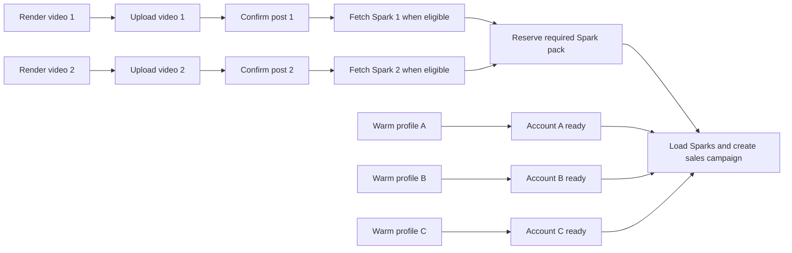

# Central concurrency and workflow system

Status: proposed implementation plan; no production scheduling behavior changed.
Prepared: 2026-09-24, from the current working tree, including existing uncommitted changes.

## 1. Intended behavior

One durable scheduler coordinates all work: rendering, TikTok uploads, Spark retrieval, Business Center warm-up, Spark loading, white-hat checks, balance checks, and future operations.

Submit the entire plan at once. Run every eligible operation for which resources are available. A waiting account, phone, profile, or video blocks only work that depends on it. Each profile keeps its own steps in order; different profiles progress independently. They do not need to finish each stage together.

For example, video 1 can finish rendering and upload on account A while videos 2 and 3 render. Once its post is confirmed and its Spark eligibility delay expires, Spark retrieval can start on A's phone. Account B can upload another video. Three BC profiles can progress through warm-up, subject to their host's browser capacity. A due balance check can run on another available profile. A sales launch becomes eligible when its assigned Sparks and account readiness requirements are satisfied.

“All videos at once” means all are submitted and available for parallel rendering, with a bounded number of encoders actually running. Unlimited FFmpeg processes would compete for the same CPU and memory. Default to starting downstream work per completed video; offer an explicit `all_renders_complete` dependency only for plans that require that barrier.

## 2. What exists today

These are code findings, not a live production capacity measurement:

- `app/job_runtime.py`, `JobRuntime`: separate in-process, per-user FIFO queues for batches, uploads, Facebook, Sparks, and provisions. Pending callables live in memory; durable snapshots do not reconstruct execution by themselves. Current defaults are two render batches and one upload job per user, with one Spark and one provision job per user.
- `app/jobs.py`, `_run_batch`: renders items in a loop; `maybe_auto_upload_batch` runs after the batch finishes. A batch slot is not a per-video render slot.
- `app/tiktok_upload.py`, `_run_job_inner`: loops over upload items, chooses a forced or round-robin account, and waits inside the job. Account post times and rate penalties are process-local dictionaries. The inspected per-account cooldown call is in the HTTP-engine path. Studio and HTTP need a common scheduling policy.
- `app/spark_jobs.py`, `_run_job_inner`: processes phone groups sequentially and sleeps for post settling. `app/spark_phone_lock.py` already has renewable cross-host phone ownership through a configured coordinator/D1, and local-only file locks. Preserve that protection during migration.
- `app/provision_jobs.py`, `_run_job`: completes each `_run_item` before proceeding. The start guard rejects another active provision job. `_run_item` also searches existing job profiles when its item has no profile ID; that recovery path must get stable item identity before parallelization, or two items can adopt the same profile.
- `app/provision_worker.py`: a thread pool defaults to four steps, while profile creation, login, and BC setup have a global exclusive-kind guard. `app/provision/inventory.py` provides CAS-based step mutation and selected conflict rules; it is not a universal resource scheduler.
- White-hat monitoring has long-running waits in `app/provision_worker.py` and `app/provision/whitehat/watch.py`. `finance/balance.py` includes payment operations; a read-only recurring balance check needs its own explicit handler.
- `app/main.py` currently stops orphaned provision jobs and fails orphaned render/upload/Spark jobs on startup. Migration must preserve intentional Stop and Continue behavior while introducing controlled recovery.
- `worker/wrangler.jsonc` configures one cloud container at 8 GiB, D1 application state, R2 storage, and an existing container Durable Object. Its comment assumes restricted Chromium/FFmpeg concurrency. Shared host memory accounting is required before increasing simultaneous work.

Increasing those independent queue limits would leave cooldowns, shared sessions, recovery, and resource conflicts unresolved.

## 3. Architecture decision

Add a dedicated SQLite-backed Cloudflare Durable Object, `WorkCoordinator`, as the scheduling authority. Keep it separate from `CaptionToolContainer`, so orchestration survives compute restarts and does not require the rendering container to remain awake.

Use one coordination domain per installation initially, covering every user and every shared host, phone, provider quota, and browser profile in that installation. Include tenant ownership in every operation and authorization check. Do not create an independent scheduler per user when those users share physical resources. A physical resource must belong to exactly one coordination domain. Future sharding is by disjoint resource fleets, after measured need; moving a resource requires draining its old domain.

Responsibilities:

- **WorkCoordinator:** durable workflows and operations, dependency resolution, account selection, resource reservations, cooldowns, deadlines, schedules, leases, retries, cancellation, event log, and dispatch decisions.
- **Python workers:** execute existing render, upload, phone, and browser logic. Workers pull only work matching their capabilities and report checkpoints/results. They do not make independent scheduling decisions.
- **D1:** existing application/catalog data and eventually consistent scheduling summaries for list pages. The coordinator's SQLite storage owns execution state. Summary projections never grant execution permission.
- **R2:** render outputs, thumbnails, screenshots, and larger diagnostic artifacts. Scheduler records contain references and checksums.
- **Existing APIs and MCP:** submit workflows, inspect progress, stop/continue, set policies. Existing job IDs remain addressable through an adapter.

Cloudflare documents transactional, strongly consistent Durable Object storage and synchronous SQL transactions. Alarms can wake a coordinator for delayed work, but each object has one alarm and delivery is at least once. Use the earliest due timestamp and make alarm processing idempotent. Sources: [SQLite storage](https://developers.cloudflare.com/durable-objects/api/sqlite-storage-api/), [alarms](https://developers.cloudflare.com/durable-objects/api/alarms/).

This backend choice fits the existing deployment. Keep a narrow scheduler client and a versioned protocol so executors do not depend on Cloudflare storage APIs. A Redis/Celery queue alone would still need the workflow, allocation, and recovery layer. A larger workflow platform is a future alternative if scale or operational requirements justify replacing the coordinator.

## 4. Workflow structure and task granularity

A workflow is the user's request; an operation is one independently schedulable unit; an attempt is one execution of that operation. A batch is a view over many operations, never the unit that monopolizes a worker.



The graph is illustrative: actual sales nodes are per target account and depend only on their assigned pack and readiness, not every profile or every Spark in the plan.

Initial operation types:

1. `render.video`, `render.carousel`, `artifact.publish`: produce and durably validate one artifact. Collapse publish into render completion only when durability is already guaranteed.
2. `tiktok.upload`, `tiktok.confirm_post`: upload one item and resolve its stable post ID/URL. If upload already returns a verified identity, confirmation completes immediately.
3. `spark.fetch`, with persisted submit/wait/collect phases: retrieve a code for one known post. Dependent on post identity and eligibility time, not completion of other uploads.
4. `bc.allocate`, `bc.create_profile`, `bc.login`, `bc.setup`, `bc.whitehat.create`, `bc.whitehat.check`: one independent chain per requested BC/profile. Split existing compound handlers at safe persisted checkpoints.
5. `bc.spark.load`, `bc.sales.create`: exact target advertiser and exact Spark assignments. Dependencies can require all of an assigned pack or a validated minimum-count policy.
6. `bc.balance.check`, `bc.status.check`, `phone.idle_cleanup`: recurring or delayed short operations.
7. Future adapters: Facebook publishing, analytics refresh, ingestion, image generation, and other background features use the same registration contract. Ordinary UI reads do not become workflow jobs.

Dependency semantics must be explicit: success, terminal completion, artifact available, or a validated condition. Required dependency failure marks dependents blocked with a reason; unrelated siblings continue. Partial-success workflows report succeeded/failed/blocked counts. Recurring monitoring is a separate subscription linked to a finished launch, so a launch does not stay “running” forever.

## 5. Durable records

Store normalized scheduler records rather than rewriting a single large job document.

**Workflow:** `id`, `tenant_id`, `request_key`, `kind`, `schema_version`, `policy_version`, `state`, `cancel_epoch`, creation/update times, original request references, legacy job ID. Unique `(tenant_id, request_key)` makes submission retries safe. Reuse with a different payload is rejected.

**Operation:** `id`, `workflow_id`, `kind`, `handler_version`, `input_ref`, stable subject IDs, `state`, `priority_class`, `ready_since`, `not_before`, optional deadline, resource demands, eligible account set or pinned account, attempt budget, checkpoint, output references, dependency policy, revision, and structured wait/error reason.

**Dependency:** parent/child operation IDs and condition. Validate ownership, cycles, graph size, and task schema at submission. Bound fan-out and materialize huge plans in chunks without dropping logical dependencies.

**Attempt:** operation ID, sequence, worker/host/boot IDs, lease token, resource fencing generations, lease deadline, started/finished times, heartbeat, error category, external task/request ID, side-effect intent and evidence. Keep late evidence even when it cannot mutate current state.

**Resource and lease:** canonical physical resource ID, owner/access scope, capacity, used units, health, optional cooldown, generation; leases record holder, quantities, expiry and occupancy type. Use immutable provider IDs, not display names. Multiple aliases for the same phone/account/profile resolve to the same key.

**Account policy:** enabled/health/session status, permitted offers/geos/content types, post spacing, time window, rate-limit scope, `next_upload_at`, penalties, and assignment history. Cooldowns are durable and shared across processes.

**Allocation:** stable item-to-profile binding, proxy/Hoot ownership, Spark reservations and monetary budget reservations. These are business allocations, separate from expiring worker leases. A worker disconnect must never silently free a BC's proxy or reuse a committed Spark allocation.

**Schedule:** subject, operation kind, interval policy, `next_due_at`, last observation, freshness deadline, enabled state, coalescing key. Permit only one live check per subject/kind.

**Event/outbox/inbox:** unique event/callback ID, tenant, entity revision, correlation ID, compact payload/reference, delivery status, and timestamps. Commit result and resulting event together; replay projections idempotently. Keep operational history bounded and export older diagnostics if needed.

Index ready operations by state/time/priority, dependencies by parent, leases by resource/expiry, and schedules by due time. Do not scan all historical jobs to find runnable work.

## 6. Eligibility and resource policy

An operation runs only when its dependencies, due time, tenant permissions, account policy, worker capabilities, external quotas, and all resource demands are satisfied in one atomic claim.

Independent limits:

- **Host CPU and memory:** weighted capacity shared by FFmpeg, Chromium, uploads, and supporting processes. Count resident browsers even when they are not actively clicking. Set FFmpeg thread limits to match reserved CPU. Reserve measured operating headroom and bound scratch disk/R2 transfer staging.
- **Host browser capacity:** number of open browser sessions, plus an activity limit. A retained idle browser still owns memory/session capacity; idle timeout closes it or records continued occupancy.
- **TikTok account activity:** one conflicting interactive operation per account by default, regardless of upload engine. Cooldown for uploads is separate from account activity. Spark fetching can run during upload cooldown once the prior action has finished; it cannot overlap a conflicting active session by default. Accounts on distinct devices run concurrently.
- **Phone/device:** one active RPA controller per physical phone, across users, accounts, Spark retrieval, cleanup, and future phone-based uploads. Different phones can run in parallel, within provider quota and cost limits.
- **AdsPower profile:** one active controller per profile across login, setup, white-hat, sales, monitoring, and manual actions. Three different profiles may run together if the host has capacity.
- **Host focus/global desktop:** only handlers that actually depend on shared OS focus or clipboard request this exclusive resource. Start with the existing sensitive guard preserved through the bridge, then prove isolation before narrowing it. Independent CDP connections alone do not prove every helper is isolated.
- **Provider API:** shared rate tokens and concurrent request limits for AdsPower, DuoPlus, Hoot, storage, and other services. Retries consume the same quotas as first attempts.
- **Tenant/workflow:** fair share of host resources, maximum active work, outstanding queue limit, and spend constraints. One large launch must not consume every phone, browser and render slot indefinitely.

Do not infer readiness from cookies alone. Authentication failures pause affected account work and schedule an explicit session repair or user action. Platform-wide or provider-wide backoff applies to the appropriate whole resource scope; using another account must not bypass a broader restriction.

The screenshot's single manual proxy cannot supply three independently assigned profiles under current UI rules. Multi-profile launch requires enough eligible proxy/Hoot inventory or a future multi-proxy input. Preflight the full allocation request and atomically reserve inventory before browser work begins.

Initial deployment limits are configuration proposals, not benchmarks: profile activity target 3 after isolation tests; one active operation per account/profile/phone; per-host render and browser counts determined by measured memory/CPU. The existing 8 GiB cloud host must be profiled with the mixed workload before claiming a safe simultaneous render/upload count. Independent execution on the PC can overlap cloud rendering without sharing that cloud memory budget.

## 7. Claim algorithm, fairness, and worker protocol

On enqueue, result, released resource, heartbeat change, callback, or alarm:

1. Resolve newly satisfied dependencies and due waits. Reconcile expired claims; do not automatically replay uncertain external mutations.
2. Consider only operations compatible with an available worker. Choose among tenants/workflows using deficit round robin with estimated resource cost. Within each share use priority, due-monitor deadlines, and aging.
3. For unassigned uploads, filter accounts by policy/health/ready time; choose a ready account by fairness and session affinity. A forced account remains pinned. Atomically bind the account and claim its resources. Freeze identity before any publish attempt; never migrate an ambiguous upload to another account.
4. In a synchronous coordinator transaction, recheck revision/cancellation/due time, acquire the complete resource set, debit quota reservations, create an attempt and lease, and mark the operation claimed. If any requirement fails, acquire nothing and consider other eligible work.
5. Worker starts only after it receives the committed grant. A lost claim response is recoverable by request ID. Renewals and completion require the attempt token and current fencing generations.
6. Atomically apply result/checkpoint, cooldown updates, resource release or continued external occupancy, and events/dependent transitions. Project legacy views asynchronously through the outbox.

Never hold one lock while waiting to acquire another. Do not reserve a phone or browser slot for an operation that is merely cooling down. Bound each scheduling pass and re-arm the earliest due alarm. Notifications accelerate dispatch; periodic worker reconciliation and a coarse watchdog recover missed wake-ups. Failed alarm retries must not leave work asleep indefinitely.

Worker registration includes tenant/resource authorization, stable host ID, process boot ID, supported handler versions, device inventory, memory/CPU capacity, and available execution slots. Use a proposed 20-second heartbeat and 90-second lease as starting values, with measured adjustment. Use coordinator time for durable deadlines and a conservative local monotonic deadline for stopping actions after lease loss.

Control endpoints: `submit_workflow`, `get_workflow`, `explain_wait`, `pause/resume/cancel`, `register_worker`, `claim`, `heartbeat`, `checkpoint`, `complete`, `reconcile_result`, and `record_callback`. Version the protocol and validate every boundary. Derive tenant identity from authentication; never accept an arbitrary user-supplied tenant for access. Credential references resolve only on authorized workers and never appear in events or general status responses.

Proposed priority classes are urgent state reconciliation, user-triggered work, due monitoring, and maintenance. Reserve a configurable share of dispatch opportunities for due monitors and age old work. These are admission preferences; they cannot create capacity or preempt a publish/payment halfway through. A check blocked by an occupied browser reports overdue freshness and waits for a safe checkpoint. Duplicate monitor ticks coalesce rather than forming a backlog.

## 8. Waiting, remote tasks, and recovery

Operation states: `blocked`, `ready`, `leased`, `running`, `waiting_time`, `waiting_external`, `reconciling`, `paused`, `succeeded`, `failed`, `cancelled`. An unresolved resource conflict can remain ready with a structured wait reason. Leased means granted but not yet acknowledged as running. Only active execution consumes worker slots.

Distinguish two kinds of waiting:

- **Time/dependency wait:** upload cooldown, post settling, review pending, retry delay. Persist `not_before` or dependency and release execution slots and unnecessary devices. Short UI loading waits can remain inside a bounded operation.
- **External activity:** an RPA task submitted to DuoPlus may continue running after the Python worker releases its compute slot. Keep phone occupancy until callback or authoritative status confirms completion/cancellation. A worker heartbeat expiry is not proof that the phone is idle. If status is unknown, quarantine that device pending reconciliation.

Use at-least-once delivery with idempotent processing. Do not promise exactly-once external side effects. Uploads, payments, campaign creation and BC creation can succeed just before a network failure hides their result.

Before an external mutation, durably record intent, a stable operation key, selected account, expected target, and known external IDs. After an ambiguous outcome, enter reconciliation and inspect the existing post/campaign/payment/task. Reuse the confirmed result or require user intervention if uniqueness cannot be established; never blindly publish or charge again. Where a provider supports idempotency keys, use them in addition to reconciliation.

Fencing rejects late workers' state writes but cannot undo a browser click. Workers must stop issuing commands upon lease loss and check ownership before irreversible actions. Do not reassign an uncertain external resource merely because the TTL expired. Reconcile its outstanding operation or confirm it stopped first. This is especially important for phones with remotely running RPA tasks.

Retry categories: transient network/provider errors use persisted backoff with jitter and an attempt/deadline budget; rate limits update the correct resource cooldown; invalid input is terminal; authentication/session errors block the affected identity; ambiguous mutations reconcile. Repeated provider failures open a scoped circuit breaker with bounded probes. Infrastructure waits must not consume mutation retry budgets.

On restart, rebuild readiness from durable records; reclaim only expired execution leases and reconcile uncertain work. Completed artifacts are reused by checksum and settings key. No process-local `_account_last_post` map is authoritative. Deliberate stops remain stopped.

Pause prevents new claims and lets active operations reach a safe boundary. Cancel increments a durable epoch, suppresses new work and downstream launches, and asks active handlers to stop. A post already published remains recorded even if cancellation wins the UI race; preserve that evidence without scheduling cancelled descendants. Continue creates a new execution generation from valid checkpoints rather than clearing a sticky cancel flag on an old attempt.

## 9. Rendering, uploads, Sparks, and BC integration details

**Rendering:** extract a single-item renderer from `_run_batch`. Each FFmpeg process gets its own subprocess group, cancellation signal, unique scratch path and resource grant. Deduplicate on source/settings/caption identity with atomic ownership. Upload can start only when its artifact is durable and readable by its assigned host; a local path alone is not cross-host availability. Persist item-level catalog updates with CAS/transaction semantics rather than racing whole-document writes.

**Uploads:** extract a single-item uploader from `_run_job_inner`. Create Playwright contexts on their owning execution thread; do not share a synchronous Playwright session across threads. Reuse sessions only through an explicitly owned worker-local session cache. Apply persistent account eligibility to both engines. Replace sleeps for upload spacing/backoff with delayed operations. Preserve existing forced account choices, captions, continue-on-error behavior and published-post recovery.

**Sparks:** migrate from whole phone-group jobs to one-post operations, allowing bounded batching only as an optimization under one device lease. Post confirmation schedules retrieval automatically when enabled by the plan. The current 180-second settle default becomes a policy timestamp followed by bounded eligibility checks, not a guarantee that Ad settings is available. Pin verified account ID, post ID and phone ID; validate code-to-post association and duplicate results. Authenticate callbacks, deduplicate by provider task/event ID, and tolerate callback-before-submit-response, repeats and out-of-order delivery.

**BCs:** create durable `(workflow_id, item_index)` bindings and inventory reservations before fan-out. Allocate three profile chains together and let each advance independently. Replace global start rejection after shared resource grants are authoritative. Preserve one controller per profile, monetary budget reservations, Spark reservations, resume checkpoints, disapproval guards, and existing session identity checks. A slow or failed profile must not block independent sibling profiles.

**Monitoring:** replace long white-hat waits with one observation followed by a persisted next check. Reauthentication is explicit dependent work; a monitor cannot secretly become a long setup job. Balance checks collect a read-only observation with timestamp, currency and source account. Existing authorized payment actions are distinct mutation operations with budget reservations and reconciliation. Checks never imply permission to add money. Stopped/disapproved/deactivated profiles disable inapplicable schedules. A due phone cleanup takes the same device ownership and rechecks newer queued activity before shutdown.

**Shared state audit:** catalog, plan pairs, account cursors, Hoot/proxy allocation, finance rotation, spend records, Spark reservations and legacy job summaries need per-entity revisions or atomic updates. A concurrency-safe scheduler does not make application-level read/modify/write operations safe automatically.

## 10. Extension contract

Register each operation kind with a versioned descriptor:

```text
kind: spark.fetch
version: 1
input: tenant, verified account ID, post ID, phone ID, catalog reference
capability: duoplus.spark.v1
resources: account interaction (1), phone (1), provider rate tokens
prerequisites: post confirmed, post eligible, account authorized
timeout/lease/retry: bounded, typed policy references
side_effect_class: external mutation with reconciliation
executor: returns Success | Defer(until) | AwaitExternal(task_id)
          | Block(reason) | Retry(category) | Ambiguous(evidence)
checkpoint/reconcile/cancel: required for externally mutating handlers
output: verified Spark code reference and post identity
```

Adding a feature means registering its schema, resource resolver, executor, recovery behavior, projection and dependency builder. It does not introduce another daemon queue, independent semaphore, or hand-written cooldown loop. The scheduler core should not import TikTok, AdsPower or rendering business logic.

One versioned JSON protocol/schema should generate or validate both TypeScript coordinator and Python worker types. Pin handler/policy versions in persisted operations; deploy new versions without changing the interpretation of already-running work. Unsupported versions wait for a compatible worker rather than failing mysteriously.

Suggested new modules: `worker/src/orchestration/` for coordinator/schema/policy/routes; `app/orchestration/` for client/protocol/registry/worker; `app/orchestration/handlers/` for domain adapters. Existing modules continue to own provider/UI mechanics. `app/job_runtime.py` becomes a compatibility facade for migrated workflows.

## 11. Visibility and controls

Add an Operations view showing workflows, individual active tasks, dependency progress, account availability, phones, browser profiles, host capacity, and next monitor checks. Show concrete reasons: “Account A can upload at 14:32”, “Phone 2 is fetching Spark for video 7”, “Waiting for profile B's login”, “Render host has no memory capacity”, or “Upload outcome needs verification”.

Provide pause/continue/cancel at workflow level and account/device disable or drain controls. Show which tasks would be affected before changing a limit. Limit reductions stop new admission; they do not kill active publishes. Expose the same typed controls through existing API/MCP authorization and confirmation rules.

Keep queued, blocked, cooling down, externally running, and actively executing distinct. Display partial success and required actions directly. Measure ready-to-start latency, useful execution versus wait time, resource utilization, render throughput, publish-to-Spark latency, retry/reconciliation counts, monitor freshness, queue age, and estimated/actual operation cost. Do not show fabricated precise ETAs before timing data exists.

## 12. Implementation sequence and gates

### Phase 0 — Establish identities and invariants

Audit every execution entry point, including UI, MCP, scripts, automatic callbacks and startup recovery. Define canonical account/phone/profile/host identities. Add stable provision item bindings and atomic business allocations. Measure representative FFmpeg/Chromium memory, CPU and disk usage. Finalize protocol and resource conflict rules.

Gate: documented operation/resource inventory, repeatable measurements, and no ambiguous profile adoption or duplicate inventory ownership in tests.

### Phase 1 — Durable coordinator and legacy resource bridge

Implement coordinator storage, atomic claims, leases, cancellation epochs, timers, outbox, authentication, and worker client. Run shadow scheduling with no dispatch to compare decisions. Move all handlers touching a selected shared resource through one grant bridge before enabling new executors for it. Legacy code can continue executing whole jobs temporarily while declaring its actual resources.

The separate Spark coordinator/phone lock must be bridged or drained and cut over explicitly. Two lease authorities must never independently grant the same phone. During a bridge, keep a single authority and pass ownership through nested helpers rather than acquiring a second unrelated lock.

Gate: adversarial claim races, lease loss, restart, duplicate callbacks, tenant isolation and outage tests pass. Shadow mode cannot submit external work. Coordinator outage stops new mutations instead of falling back to local scheduling.

### Phase 2 — Three-profile warm-up and short monitoring

Convert warm-up to independent per-profile graphs and replace long watch loops with scheduled checks. Validate profile/session isolation and scope the old global exclusive guard to genuine shared resources. Route manual Ads Manager actions through profile ownership too.

Gate: three fixture profiles progress concurrently, each preserves internal order and unique inventory; stopping one does not stop siblings; monitor checks do not steal an occupied profile. Perform a separately scoped live canary within the launch's normal budget/authorization before production enablement.

### Phase 3 — Per-item rendering and ready-account uploads

Extract render/upload handlers, enforce host resource budgets, persist all-engine account cooldowns, and enable per-artifact upload dependencies. Preserve all existing user-selected accounts and upload metadata.

Gate: render and upload overlap within measured memory limits; a cooling account consumes no execution slot and another eligible account progresses; restart and uncertain publish do not produce duplicate posts.

### Phase 4 — Per-post Sparks and dependent sales loading

Turn post confirmation into automatic Spark eligibility; run independent devices concurrently, preserve active RPA ownership and callback recovery, and wake exactly the sales nodes whose pack/readiness conditions are met.

Gate: upload B and Spark A overlap on independent resources; a shared phone serializes correctly; duplicate callbacks and late results never duplicate launches or change post association.

### Phase 5 — Remaining background operations and Operations UI

Migrate balance/status checks, idle cleanup, Facebook and other background work through the registration contract. Add visibility, policy editing, operational metrics and backlog/cost controls. Remove obsolete queue/sleep paths after migration coverage is proven.

Gate: every production entry point for a migrated operation uses the common authority, overdue checks are visible, and a new sample handler can be integrated without changing claim logic.

Migration flags are scoped to coherent resource ownership groups, not just feature names. Pin each workflow's engine/version at creation. Drain old work or import it with stable legacy-to-operation mappings and verified checkpoints; never let startup orphan handlers cancel imported work. Shadow mode may observe, never execute. Rollback disables new admission and drains/reconciles active new-engine operations before legacy execution regains the resources. Never blindly replay new-engine work in the old loops.

## 13. Required acceptance scenarios

Use deterministic clocks, fake providers and injected crashes for orchestration tests. Exercise actual handlers with mocked external boundaries; a test that only counts threads is insufficient.

1. Three-profile launch: overlap occurs; internal ordering holds; three unique Hoot/proxy/profile assignments; one profile failure leaves others progressing.
2. Twelve ready renders: bounded encoders use available capacity, cancellation cleans only the correct subprocess/artifacts, and video 1 uploads before the final render finishes.
3. Account A cooling, B ready: B claims eligible work immediately; A wakes at its durable timestamp; a forced-A upload stays assigned to A; cooldown survives restart.
4. Spark A plus upload B: overlap on independent resources; same account/device conflict prevents unsafe overlap; post settling holds no worker/phone slot.
5. Two phone workers racing: one owner; an external RPA task keeps device occupancy after compute release; a lost worker cannot permit a competing task until reconciliation.
6. Monitor and setup contend on one profile: no concurrent page control; other profiles proceed; the check is coalesced and freshness becomes overdue when capacity is unavailable.
7. Duplicate submission/callback/result: one logical operation and one dependent launch; reordered callbacks converge to the same confirmed result.
8. Crash before/after each publish or payment boundary: safe retries before mutation; reconciliation after uncertain mutation; no automatic duplicate external side effect.
9. Cancel versus success race: confirmed external result retained, cancelled descendants suppressed, late lease holder cannot overwrite current state; Continue uses a new generation.
10. Cloud/local API restart, worker restart, coordinator timeout and clock skew: waits and cooldowns survive; no local fallback execution; stopped workflows stay stopped.
11. Mixed stress: renders, three BCs, uploads, phone tasks and checks obey host limits; increasing users does not multiply physical capacity; tenant fairness and monitor deadlines are observable.
12. Capacity changes and device disconnects: reduce admission without killing irreversible work; healthy resources continue; unknown external occupancy is quarantined.
13. Projection outage: coordinator remains authoritative; replay repairs catalog/job views; a stale UI cannot trigger duplicate work; an output required by a consumer is delivered by value/reference or gated on projection readiness.
14. Migration and rollback: old and new paths cannot both own a device; imported jobs survive startup recovery; fully drained rollback preserves cancellation, allocations and publish evidence.

## 14. Decisions and remaining measurements

Decisions proposed here: one central durable authority; operation-level scheduling; independent profile progress; persistent cooldowns; one controller per shared account/session/device; per-item pipeline; short scheduled monitors; cautious reconciliation of external mutations; phased integration with existing handlers.

Measurements still needed during implementation: safe mixed cloud/PC memory limits, per-operation runtime/cost, which browser helpers need global focus, exact device-to-account mapping, provider-wide rate scopes, and expected peak queue size. These determine capacity settings, not whether to build separate schedulers. For launch policy, preserve existing selected accounts, geos, spend limits and intentional Stop/Continue semantics.

The first useful production milestone is the durable coordinator plus three independent warm-up chains. The complete milestone is a plan where rendering, eligible-account uploads, per-post Spark retrieval, account preparation and recurring observations all share this same scheduler and visibly overlap.
